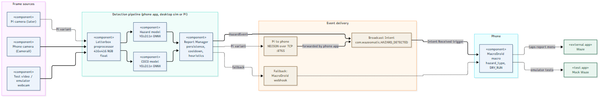

# Wazeomatic

Wazeomatic reports road hazards to Waze automatically. A phone mounted like a dashcam runs a small YOLO object detector with ONNX Runtime. When a hazard (pothole, cones, construction, animal) has been seen in enough frames, the detector app sends an Android broadcast. A MacroDroid macro picks it up and taps through the Waze report menu. A Raspberry Pi can later replace the phone camera and send detections to the phone over the local network.

Status: end of sprint 1. Working pieces: desktop pipeline and simulator, fine-tuned hazard model (pothole, cone, construction sign, delineator) exported to ONNX, Android detector app, mock Waze app with an automated Pixel 9 Pro emulator test. See [docs/sprint1.md](docs/sprint1.md).

## Architecture at a glance



Diagram source: [docs/diagrams/01_component.mmd](docs/diagrams/01_component.mmd); sequence and class views are in [docs/architecture.md](docs/architecture.md).

```
camera/video -> ONNX Runtime (hazard + COCO YOLO11n) -> ReportManager (3 of 10 frames, 60 s cooldown)
            -> broadcast com.wazeomatic.HAZARD_DETECTED -> MacroDroid macro -> Waze report menu
```

## Repository layout

| Path | Contents |
|------|----------|
| `wazeomatic/` | Desktop pipeline: hazard schema, ONNX detector, report manager, video simulator |
| `tools/` | Dataset preparation, training, ONNX export/quantisation, benchmarks, test video download |
| `models/` | Exported `.onnx` files (not committed, see [models/README.md](models/README.md)) |
| `assets/videos/` | Test dashcam clips (not committed, see [assets/videos/README.md](assets/videos/README.md)) |
| `android/detector/` | Phone app: camera or video source, ONNX Runtime inference, broadcast sender, TCP receiver |
| `android/mockwaze/` | Mock Waze app with the same report menu, used for automated tests |
| `tools/emulator/` | Emulator test scripts (Pixel 9 Pro profile, API 35) |
| `android_setup/` | MacroDroid macro setup guide ([macro_setup_guide.md](android_setup/macro_setup_guide.md)) |
| `docs/` | Project documentation (this wiki) |

## Quick start

### Desktop simulator

```powershell
python -m venv .venv; .venv\Scripts\activate
pip install -r requirements.txt
python tools/fetch_test_videos.py                      # CC0 dashcam clips into assets/videos/
python tools/export_onnx.py --coco                     # stock COCO model -> models/coco_yolo11n_416.onnx
python -m wazeomatic.run_video assets/videos/dashcam_urban_1080p.mp4 --sink stdout --record runs/sim/out.mp4
```

`--sink tcp:<phone-ip>:8765` sends events to the phone app, `--sink adb --adb-dry-run` fires the broadcast on a connected device or emulator, `--camera-sim` degrades frames to phone-camera quality, `--zoom-crop` adds a second pass on the road ahead for small distant hazards, `0 --camera` reads a webcam (`tools/camera/start_obs_camera.ps1` turns a clip into one). `tools/eval_events.py` scores report events, not just boxes. Details: [docs/simulation.md](docs/simulation.md).

### Training and export

```powershell
pip install -r requirements-train.txt                  # plus a CUDA build of torch
python tools/fetch_rdd2022_potholes.py                 # pothole images of RDD2022 (all countries) -> F:\dev\datasets\rdd2022_full
python tools/prepare_datasets.py --out F:/dev/datasets/wazeomatic_hazards_640 --tile 1024   # StarLine frames tiled at native resolution
python tools/train.py --data F:/dev/datasets/wazeomatic_hazards_640/data.yaml --imgsz 640 --batch 16
python tools/export_onnx.py --weights runs/train/hazard640/weights/best.pt --imgsz 640
python tools/quantize_onnx.py models/hazard_yolo11n_640.onnx
python tools/bench_onnx.py models/hazard_yolo11n_640.onnx
python tools/eval_events.py --model models/hazard_yolo11n.onnx --data F:/dev/datasets/wazeomatic_hazards_640 --sweep
```

Model choice, datasets and results: [docs/model-research.md](docs/model-research.md).

### Android apps

`android/detector` and `android/mockwaze` are separate Gradle projects (`gradlew.bat assembleDebug` in each, or open in Android Studio). Install `detector` on the phone. Copy the `.onnx` files from `models/` as described in the app's own README. Install `mockwaze` only on test devices and emulators.

### Emulator suite

Pixel 9 Pro emulator profile with the API 35 `google_apis` x86_64 image (WHPX on Windows). Setup and scripts: [tools/emulator/README.md](tools/emulator/README.md).

### MacroDroid macro

Follow [android_setup/macro_setup_guide.md](android_setup/macro_setup_guide.md), then add the Intent Received trigger and `DRY_RUN` variable described in [docs/pipeline-to-macro.md](docs/pipeline-to-macro.md). Do not test against real Waze with `DRY_RUN` off: every report is live.

## Documentation

| Doc | Topic |
|-----|-------|
| [architecture.md](docs/architecture.md) | Components, data flow, phone vs Pi deployment, safety design |
| [model-research.md](docs/model-research.md) | Model and runtime comparison, datasets, class schema, results |
| [pipeline-to-macro.md](docs/pipeline-to-macro.md) | Event JSON, Intent contract, MacroDroid setup, fallbacks |
| [simulation.md](docs/simulation.md) | Desktop simulator, emulator suite, dry-run testing |
| [sprint1.md](docs/sprint1.md) | Sprint 1 goals and what was delivered |
| [user-stories.md](docs/user-stories.md) | User stories with story points |
