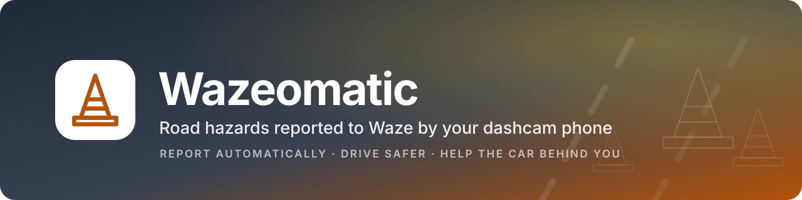
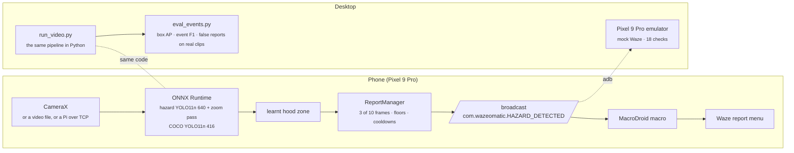

<a name="top"></a>
[](#top)
[](#numbers)
[](#phone)
[](#desktop-simulator)
[](#phone)
[](#development)
[](#safety)
[](#safety)

**A phone mounted like a dashcam that watches the road, decides when it has really seen a pothole or a work
zone, and taps through the Waze report menu for you. On-device detection, a report manager that wants proof
before it believes a detection, a desktop simulator with event-level evaluation, and an automated emulator test
against a pixel-matched mock of Waze.**

> [!NOTE]
> This is an independent course project. It is not made by, endorsed by, or affiliated with Waze or Google.
> Nothing in this repository files a report on its own: the macro stops one tap before Report unless you turn
> that off, and the project's own rule is that testing against the real app stays a dry run.

## Table of Contents
- [About](#about)
- [What it reports](#what-it-reports)
- [How it works](#how-it-works)
- [Numbers](#numbers)
- [Desktop simulator](#desktop-simulator)
- [Phone](#phone)
- [Emulator suite](#emulator-suite)
- [Training](#training)
- [Safety](#safety)
- [Layout](#layout)
- [Development](#development)
- [Documentation](#documentation)

## About

Waze reports are typed by hand, which is the one thing a driver should not be doing. The camera already sees the
cone line, the lane-closed sign and the pothole long before the driver reaches for the phone. Wazeomatic turns
that into the report:

- **Everything runs on the phone.** A YOLO11n detector in ONNX Runtime, a second pass on a zoomed crop of the road
  ahead for small distant hazards, and a hood zone that the app learns from the picture itself (the dashboard
  keeps sharp edges in a running average of the frames while the road blurs away). No server, no upload.
- **It wants proof.** A hazard has to be seen in 3 of the last 10 inference frames above a per-class confidence
  floor before it becomes an event, and each hazard type is reported at most once a minute. One event per real
  hazard, none for a reflection in the windscreen.
- **The report is a broadcast.** The app sends `com.wazeomatic.HAZARD_DETECTED` with the Waze category and
  subtype as extras. A MacroDroid macro picks it up and presses the same tiles a person would.
- **The desktop runs the same pipeline.** Box fusion, zoom, hood zone and the report manager exist once in Python
  and once in Kotlin with the same defaults and the same unit tests, so a threshold tuned against real dashcam
  footage on the desktop is the threshold the phone ships.
- **Measured on reports, not boxes.** The evaluation harness scores the events the report manager would emit:
  recall on synthetic clips, the false-report rate on twelve minutes of real footage, and a real lane closure
  as the positive control.

## What it reports

| What the camera sees | Model classes | Event | Waze menu |
| --- | --- | --- | --- |
| Cones, drums, tubular markers, vertical panels | `cone`, `delineator` | `HAZARD_ON_ROAD_CONSTRUCTION` | Hazard › Construction |
| Temporary traffic signs, arrow and message boards | `construction_sign` | `HAZARD_ON_ROAD_CONSTRUCTION` | Hazard › Construction |
| Barricades, barriers, workers in hi-vis | `barricade`, `worker` | `HAZARD_ON_ROAD_CONSTRUCTION` | Hazard › Construction |
| A pothole in the lane ahead | `pothole` | `HAZARD_ON_ROAD_POTHOLE` | Hazard › Pothole |
| An animal on or near the road (stock COCO model) | `dog`, `horse`, `cow`, ... | `HAZARD_SHOULDER_ANIMALS` | Hazard |

The class schema and the mapping live in [configs/classes.yaml](configs/classes.yaml) and
[wazeomatic/schema.py](wazeomatic/schema.py); the event JSON and Intent contract are in
[docs/pipeline-to-macro.md](docs/pipeline-to-macro.md).

## How it works



## Numbers

Measured on the same 1,201 held-out images and the same five real clips; every run is in
[docs/model-research.md](docs/model-research.md).

| | sprint-1 model | current (v3 nano) | v3 small |
| --- | --- | --- | --- |
| Box AP50, all classes | 0.16 | 0.39 | 0.42 |
| Construction event recall | 0.55 | 0.85 | 0.89 |
| Overall event F1 | 0.66 | 0.82 | 0.85 |
| False reports on 12 min of real footage | 0 | 0 | 0 |
| Model time per frame, desktop CPU, zoom on | 29 ms | 25 ms | 86 ms |

The v3 models were trained on 45,855 images from seven sources: StarLine road-work frames, CMU ROADWork, Argoverse
2 front-camera logs with the 3D labels projected into the image, RDD2022 and three pothole sets. The v3 nano ships;
the v3 small is one build flag away for a phone that can afford it.

## Desktop simulator

Python 3.10 or newer:

```powershell
python -m venv .venv; .venv\Scripts\activate
pip install -r requirements.txt
python tools/fetch_test_videos.py                      # CC0 dashcam clips into assets/videos/
python tools/export_onnx.py --coco                     # the stock COCO model into models/
python -m wazeomatic.run_video assets/videos/dashcam_urban_1080p.mp4 --sink stdout --record runs/sim/out.mp4
```

The hazard model is not committed: train it ([Training](#training)) or drop `hazard_yolo11n.onnx` and its
`.labels.txt` into `models/`. Useful flags:

| Flag | Meaning |
| --- | --- |
| `--sink adb --adb-dry-run` | Fire the broadcast on a connected phone or emulator with `dry_run=true` |
| `--sink tcp:<ip>:8765` | Feed events to the phone app over the network (the Raspberry Pi path) |
| `--camera-sim` | Degrade frames to phone-camera quality before inference |
| `--hazard-model models/hazard_yolo11s_v3.onnx` | Run the bigger model |
| `--ensemble-model <onnx>` | Fuse another hazard model (Weighted Boxes Fusion, parallel threads) |
| `--no-zoom`, `--no-auto-hood`, `--track-iou 0.3` | Turn the zoom pass or learnt hood zone off, turn spatial tracking on |
| `0 --camera` | Read a webcam (`tools/camera/start_obs_camera.ps1` turns a clip into one) |

All of them, and the event harness, are described in [docs/simulation.md](docs/simulation.md).

## Phone

```powershell
cd android/detector
.\gradlew.bat assembleDebug                            # bundles models/hazard_yolo11n.onnx and the COCO model
adb install -r app\build\outputs\apk\debug\app-debug.apk
```

Mount the phone like a dashcam and start the detector. Then install MacroDroid, follow
[android_setup/macro_setup_guide.md](android_setup/macro_setup_guide.md), and add the Intent Received trigger and the
`DRY_RUN` variable from [docs/pipeline-to-macro.md](docs/pipeline-to-macro.md). Keep `DRY_RUN` on until you have
watched the macro stop at the confirm sheet a few times.

Build flags: `-PhazardModel=hazard_yolo11s_v3.onnx` swaps the model, `-PhazardModel2=hazard_yolo11s_v3.onnx` fuses a
second one on the device. Runtime settings (thresholds, zoom, hood zone, ensemble) are launch extras and are listed
in [android/detector/README.md](android/detector/README.md).

## Emulator suite

A Pixel 9 Pro profile (API 35, `google_apis` x86_64) with a mock Waze that copies the 2024 report flow tile for tile
and logs every tap. The real app refuses to sign in on emulators (Play Integrity), so the mock is the emulator target.

```powershell
powershell tools\emulator\create_avd.ps1               # once
python tools/emulator/run_e2e.py --install --video-seconds 60
```

Boots the emulator, installs both apps, rehearses the macro's taps, replays a clip through the detector and checks
that every mock report traces back to a detector event: 18 checks. Setup and scripts are in
[tools/emulator/README.md](tools/emulator/README.md).

## Training

```powershell
pip install -r requirements-train.txt                  # plus a CUDA build of torch
python tools/fetch_rdd2022_potholes.py                 # RDD2022 potholes
python tools/fetch_argoverse_hazards.py --stage annotations
python tools/fetch_argoverse_hazards.py --stage images --logs 100 --every 4
python tools/argoverse_to_yolo.py --check 6            # project the 3D cuboids, render a few frames to look at
python tools/prepare_datasets.py --out C:/dev/datasets/wazeomatic_hazards_v3 --tile 1024 --tile-sources starline roadwork argoverse --tile-size roadwork=1080 --tile-size argoverse=1280
python tools/train.py --data C:/dev/datasets/wazeomatic_hazards_v3/data_train.yaml --imgsz 640 --batch 32
python tools/export_onnx.py --weights runs/train/hazard/weights/best.pt --imgsz 640
python tools/eval_events.py --model models/hazard_yolo11n.onnx --data C:/dev/datasets/wazeomatic_hazards_v3 --limit 120 --zoom-crop --sweep
```

ROADWork and StarLine are downloaded by hand (the sources, licences and sizes are tabulated in
[docs/model-research.md](docs/model-research.md)). Put the merged dataset on an SSD: from a hard disk the data
loader starves the GPU.

## Safety

- **Dry run by default.** The macro's `DRY_RUN` variable stops it one tap before Report, and the desktop and
  emulator sinks send `dry_run=true`. The mock Waze exists so that the whole loop can be tested without the real app.
- **Nothing leaves the phone.** Inference, the report manager and the broadcast are local. There is no account,
  no server and no telemetry in this repository.
- **Reports are rate limited twice.** Once per hazard type per minute in the report manager, and again by the
  macro's own one-per-minute rule.
- **What is not handled yet.** The report manager has no notion of place: a cone in a parking garage is still a
  cone. That, and a real drive with the phone, are the open items in [docs/sprint1.md](docs/sprint1.md).

## Layout

| Path | Contents |
| --- | --- |
| `wazeomatic/` | Desktop pipeline: schema, ONNX detectors, box fusion, hood estimator, report manager, video runner |
| `android/detector/` | Phone app: CameraX, video or TCP source; the same pipeline in Kotlin; broadcast sender |
| `android/mockwaze/` | Mock Waze with the 2024 report flow and an auto-macro service, for tests only |
| `tools/` | Dataset fetchers and builder, training, ONNX export and quantisation, benchmarks, event-level evaluation |
| `tools/emulator/` | Pixel 9 Pro emulator scripts and the end-to-end suite |
| `configs/` | Class schema and the mapping to Waze report types |
| `android_setup/` | MacroDroid macro guide |
| `models/`, `assets/videos/` | Exported models and test clips, not committed (see their READMEs) |
| `tests/` | Python unit tests; the Android tests live under each app |
| `docs/` | Architecture, model research, pipeline-to-macro contract, simulation, sprint status, user stories |

## Development

```powershell
pip install -r requirements.txt -r requirements-train.txt
python -m pytest -q tests                              # 51 tests
cd android/detector; .\gradlew.bat testDebugUnitTest   # 40 tests, the Kotlin twins of the Python ones
```

The emulator suite above is the integration test. Everything a model decision rests on is a run folder under
`runs/eval/` with a `results.md`, and `tools/summarize_evals.py` tabulates them.

## Documentation

| Doc | Topic |
| --- | --- |
| [architecture.md](docs/architecture.md) | Components, data flow, phone vs Pi deployment, safety design |
| [model-research.md](docs/model-research.md) | Models, datasets and licences, class schema, every measured result |
| [pipeline-to-macro.md](docs/pipeline-to-macro.md) | Event JSON, Intent contract, MacroDroid setup, fallbacks |
| [simulation.md](docs/simulation.md) | Desktop simulator flags, emulator suite, dry-run testing |
| [sprint1.md](docs/sprint1.md) | Sprint goals, what was delivered, what is open |
| [user-stories.md](docs/user-stories.md) | User stories with story points |

<p align="right"><a href="#top">Back to top</a></p>
