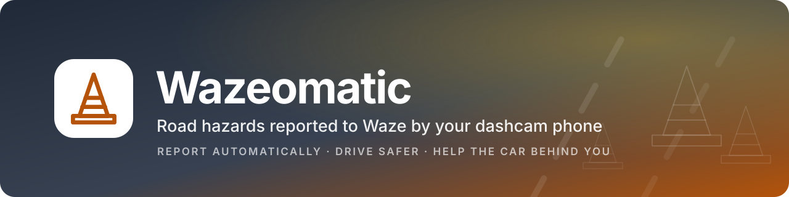
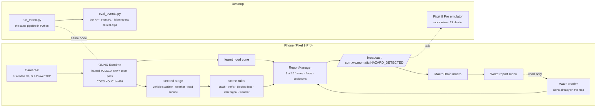

<a name="top"></a>
[](#top)
[](#numbers)
[](https://github.com/blakepennel/wazeomatic/actions/workflows/ci.yml)
[](#phone)
[](#desktop-simulator)
[](#phone)
[](#development)
[](#safety)
[](#safety)
[](LICENSE)

**A phone mounted like a dashcam that watches the road, decides when it has really seen a pothole or a work
zone, and taps through the Waze report menu for you. On-device detection, a report manager that wants proof
before it believes a detection, a desktop simulator with event-level evaluation, and an automated emulator test
against a pixel-matched mock of Waze.**

> [!NOTE]
> This is an independent course project. It is not made by, endorsed by, or affiliated with Waze or Google.
> Nothing in this repository files a report on its own: the macro stops one tap before Report unless you turn
> that off, and the project's own rule is that testing against the real app stays a dry run.

## Table of Contents
- [About](#about)
- [What it reports](#what-it-reports)
- [How it works](#how-it-works)
- [Numbers](#numbers)
- [Desktop simulator](#desktop-simulator)
- [Phone](#phone)
- [Emulator suite](#emulator-suite)
- [Training](#training)
- [Safety](#safety)
- [Layout](#layout)
- [Development](#development)
- [Documentation](#documentation)
- [License](#license)

## About

Waze reports are typed by hand, which is the one thing a driver should not be doing. The camera already sees the
cone line, the lane-closed sign and the pothole long before the driver reaches for the phone. Wazeomatic turns
that into the report:

- **Everything runs on the phone.** A YOLO11n detector in ONNX Runtime, a second pass on a zoomed crop of the road
  ahead for small distant hazards, and a hood zone that the app learns from the picture itself (the dashboard
  keeps sharp edges in a running average of the frames while the road blurs away). No server, no upload.
- **It wants proof.** A hazard has to be seen in 3 of the last 10 inference frames above a per-class confidence
  floor before it becomes an event, and at most one report goes out per minute, the same limit the macro
  enforces. A hazard that qualifies while another report holds that minute is counted as held back, not lost
  without trace.
- **The report is a broadcast.** The app sends `com.wazeomatic.HAZARD_DETECTED` with the Waze category and
  subtype as extras. A MacroDroid macro picks it up and presses the same tiles a person would.
- **The desktop runs the same pipeline.** Box fusion, zoom, hood zone and the report manager exist once in Python
  and once in Kotlin with the same defaults and the same unit tests, so a threshold tuned against real dashcam
  footage on the desktop is the threshold the phone ships.
- **Measured on reports, not boxes.** The evaluation harness scores the events the report manager would emit:
  recall on synthetic clips, the false-report rate on twelve minutes of real footage, and a real lane closure
  as the positive control.

## What it reports

Every hazard type on the Waze report menu that a camera can see. The full table, with what fires each report,
its thresholds and how well it is measured, is [docs/waze-coverage.md](docs/waze-coverage.md).

| What the camera sees | Comes from | Waze menu |
| --- | --- | --- |
| Cones, drums, temporary signs, barricades, workers in hi-vis | hazard model | Hazard › Construction |
| A pothole in the lane ahead | hazard model | Hazard › Pothole |
| Debris lying on the road | hazard model | Hazard › Object |
| An animal on or near the road | COCO model | Hazard (no animal subtype since 2024) |
| A stopped car on the right shoulder (off by default) | COCO model + box growth | Hazard › Car on shoulder |
| Two or more signal heads ahead, none lit | COCO model + lamp check | Hazard › Broken traffic light |
| A police car | COCO vehicle + vehicle classifier | Police (› Other side, off by default) |
| An ambulance or fire engine with flashing lights, at the scene | vehicle classifier + light flicker + ego motion | Crash (› Other side) |
| Stop-and-go or standing traffic for minutes | ego motion + COCO vehicles | Traffic › Heavy / Standstill |
| Fog, steady rain | weather classifier | Bad weather › Fog / Slippery road |
| Standing water, ice, snow on the road (off: no road-surface model good enough to ship yet) | road-surface classifier | Bad weather › Flood / Icy road / Unplowed road |
| Cones placed in our lane, left, centre or right | hazard model + flat-road camera model | Blocked lane › Left / Center / Right |

Before it reports, the app reads the alerts Waze already shows (an accessibility service with no rights to tap,
`WazeWatcherService.kt`; `wazeomatic/waze_reader.py` over adb on the desktop). A hazard Waze already shows
close ahead is logged as a confirmation instead of being reported twice.

The class schema and the mapping live in [configs/classes.yaml](configs/classes.yaml) and
[wazeomatic/schema.py](wazeomatic/schema.py); the event JSON and Intent contract are in
[docs/pipeline-to-macro.md](docs/pipeline-to-macro.md).

## How it works



## Numbers

Measured on the same 1,201 held-out images and the same five real clips; every run is in
[docs/model-research.md](docs/model-research.md).

| | sprint-1 model | v3 nano | v3 small | v4 nano (ships) |
| --- | --- | --- | --- | --- |
| Box AP50, all classes | 0.16 | 0.39 | 0.42 | 0.38 |
| Construction event recall | 0.55 | 0.85 | 0.89 | 0.85 |
| Overall event F1 | 0.66 | 0.82 | 0.85 | 0.80 |
| False reports on 12 min of real footage | 0 | 0 | 0 | see below |
| Model time per frame, desktop CPU, zoom on | 29 ms | 25 ms | 86 ms | 25 ms (same network) |

v4 is the v3 nano trained on with Lost and Found road obstacles as a seventh class, debris, for Hazard ›
Object. On these synthetic clips it is a little behind v3 on the classes they share; on real city driving
(the held-out Argoverse clips below) it finds 85 of 86 work zones against 81 for v3, with the same three false
reports, so it ships. On the 14.6 minutes of hazard-free drives of the current harness, run with and without
the camera simulation, v4 makes 6 reports and v3 4 ([model-research.md](docs/model-research.md#hazard-v4-debris-2026-11-14)).

The v3 models were trained on 45,855 images from seven sources: StarLine road-work frames, CMU ROADWork, Argoverse
2 front-camera logs with the 3D labels projected into the image, RDD2022 and three pothole sets. The v3 small is
one build flag away for a phone that can afford it (it has no debris class).

The second stage and the scene rules are measured separately, each on data it was not tuned on unless
[docs/waze-coverage.md](docs/waze-coverage.md) says so:

| Report | Measured on | Result |
| --- | --- | --- |
| Police | 163 held-out Argoverse 2 city clips (38 min), police cars checked by eye | 12 of 13 police clips reported; no false Police report in the 150 clips without police (the earlier two-model pair: 7 of 13) |
| Police, Crash | 14.6 min of dashcam drives | 0 false reports (one correct Police report: a parked police car in the work-zone log) |
| Construction | 163 held-out Argoverse 2 city clips scored against their 3D cone, drum and flagger labels | recall 0.99, precision 0.97 (two of the three false reports are, on review, work zones the labels call bollards) |
| Object on the road | Lost and Found val frames (120 with a small obstacle, 120 without) | recall 0.55, precision 0.89; no report on the 163 held-out Argoverse clips |
| Blocked lane | 100 Argoverse 2 logs scored against their 3D cone and drum labels | precision 0.77, recall 0.77, side right on 80 % of hits; no false report on 109 logs never used for tuning |
| Animal, Pothole, Object, Broken traffic light, Crash, Traffic | the same 163 held-out clips (38 min of city driving) | no report |
| Traffic (speed estimate under the rules) | 163 held-out Argoverse 2 clips with the car's true speed, chained into 150 s and 75 s windows | Heavy: 1 of 462 free-flowing windows (the first rule: 293), 215 of 459 slow ones; Standstill: 499 of 500 windows of real stops ([waze-coverage.md](docs/waze-coverage.md#traffic-what-the-camera-can-tell-about-our-own-speed)) |
| Pothole, Animal | one real dashcam clip each (UK street with shallow potholes; roe deer crossing a snowy road) | both missed, nothing false reported: the gaps are in the training data ([waze-coverage.md](docs/waze-coverage.md#pothole-on-a-real-dashcam)) |
| Fog / Slippery road | 2,425 held-out BDD100K frames, one frame at a time | fog threshold met on no clear frame, rain threshold on 1.5 % of clear and 70 % of rainy frames |

## Desktop simulator

Python 3.10 or newer, and ffmpeg on the PATH for the clip download:

```powershell
python -m venv .venv; .venv\Scripts\activate
pip install -r requirements.txt -r requirements-train.txt -c constraints.txt
python tools/fetch_test_videos.py                      # CC0 dashcam clips into assets/videos/
python tools/export_onnx.py --coco                     # the stock COCO model into models/
python -m wazeomatic.run_video assets/videos/dashcam_urban_1080p.mp4 --no-hazard --sink stdout --record runs/sim/out.mp4
```

That runs the whole pipeline with the stock COCO detector alone (`--no-hazard`). The hazard model's weights are
not published, because two of its training sets do not allow it ([NOTICE.md](NOTICE.md)); build it with the
steps under [Training](#training) and drop the `--no-hazard`. Without the flag a missing hazard model is an
error, not a silent COCO-only run. `requirements.txt` alone is enough to run the pipeline and the tests once
the models exist; the second file is needed for the export. Useful flags:

| Flag | Meaning |
| --- | --- |
| `--sink adb` | Fire the broadcast on a connected phone or emulator. It carries `dry_run=true` unless `--adb-live` is given |
| `--sink tcp:<ip>:8765` | Feed events to the phone app over the network (the Raspberry Pi path) |
| `--camera-sim` | Degrade frames to phone-camera quality before inference |
| `--hazard-model models/hazard_yolo11s_v3.onnx` | Run the bigger model |
| `--ensemble-model <onnx>` | Fuse another hazard model (Weighted Boxes Fusion, parallel threads) |
| `--no-zoom`, `--no-auto-hood`, `--track-iou 0.3` | Turn the zoom pass or learnt hood zone off, turn spatial tracking on |
| `0 --camera` | Read a webcam (`tools/camera/start_obs_camera.ps1` turns a clip into one) |

All of them, and the event harness, are described in [docs/simulation.md](docs/simulation.md).

## Phone

```powershell
cd android/detector
.\gradlew.bat assembleDebug                            # bundles models/hazard_yolo11n.onnx and the COCO model
adb install -r app\build\outputs\apk\debug\app-debug.apk
```

Mount the phone like a dashcam and start the detector. Then install MacroDroid, follow
[android_setup/macro_setup_guide.md](android_setup/macro_setup_guide.md), and add the Intent Received trigger and the
`DRY_RUN` variable from [docs/pipeline-to-macro.md](docs/pipeline-to-macro.md). Keep `DRY_RUN` on until you have
watched the macro stop at the confirm sheet a few times.

Build flags: `-PhazardModel=hazard_yolo11s_v3.onnx` swaps the model, `-PhazardModel2=hazard_yolo11s_v3.onnx` fuses a
second one on the device. Runtime settings (thresholds, zoom, hood zone, ensemble) are launch extras and are listed
in [android/detector/README.md](android/detector/README.md).

## Emulator suite

A Pixel 9 Pro profile (API 35, `google_apis` x86_64) with a mock Waze that copies the 2024 report flow tile for tile
and logs every tap. The real app refuses to sign in on emulators (Play Integrity), so the mock is the emulator target.

```powershell
powershell tools\emulator\create_avd.ps1               # once
python tools/emulator/run_e2e.py --install --video-seconds 60
```

Boots the emulator, installs both apps, rehearses the macro's taps, replays a clip through the detector and checks
that every mock report traces back to a detector event: 21 checks. A check that could not run is a SKIP, and a
run with a SKIP is INCOMPLETE rather than green. Setup, environment variables and the option that requires a
real hazard class to cross the broadcast are in [tools/emulator/README.md](tools/emulator/README.md).

## Training

```powershell
pip install -r requirements.txt -r requirements-train.txt -c constraints.txt   # plus a CUDA build of torch to train
$env:WAZEOMATIC_DATASETS = "D:\datasets"               # where 40 GB of data may live; default <repo>/datasets
python tools/fetch_datasets.py --list                  # sources, sizes, licences, what is on disk
python tools/fetch_datasets.py                         # the six archive-based sources (about 17 GB)
python tools/fetch_rdd2022_potholes.py                 # RDD2022 potholes
python tools/fetch_argoverse_hazards.py --stage annotations
python tools/fetch_argoverse_hazards.py --stage images --logs 100 --every 4
python tools/argoverse_to_yolo.py --check 6            # project the 3D cuboids, render a few frames to look at
python tools/prepare_datasets.py --tile 1024 --tile-sources starline roadwork argoverse --tile-size roadwork=1080 --tile-size argoverse=1280
python tools/train.py --name hazard_v3n                # yolo11n, 640 px, 40 epochs
python tools/export_onnx.py --weights runs/train/hazard_v3n/weights/best.pt --name hazard_yolo11n_v3 --ship
python tools/eval_events.py --limit 120 --zoom-crop --sweep
```

`prepare_datasets.py` stops if a source is missing rather than quietly building a smaller set. `--ship` is what
makes an export the model the pipeline and the phone build load; without it only `models/<name>.onnx` is
written. Sources, licences and sizes are tabulated in [docs/model-research.md](docs/model-research.md) and
[NOTICE.md](NOTICE.md). Put the merged dataset on an SSD: from a hard disk the data loader starves the GPU.

## Safety

- **Dry run by default, on every sender.** The macro's `DRY_RUN` variable stops it one tap before Report. The
  phone app and the desktop adb sink both send `dry_run=true` unless told otherwise, and either switch alone is
  enough to stop a live report. The mock Waze exists so that the whole loop can be tested without the real app.
- **Nothing leaves the phone.** Inference, the report manager and the broadcast are local. There is no account,
  no server and no telemetry in this repository.
- **Reports are rate limited twice, by the same rule.** One report a minute in the report manager, and the
  macro's own one-per-minute guard behind it.
- **A run that dies says so.** A dead camera, a decoder error or a missing model ends the run with an error and
  a non-zero exit instead of looking like quiet road. On the phone the status line shows a stalled pipeline and
  a battery restriction.
- **Measured in daylight only.** Night, rain and wet roads are unmeasured, and the pin lands where the phone is
  when the sheet sends, not where the hazard was. Both are spelled out in
  [docs/responsible-use.md](docs/responsible-use.md).
- **What is not handled yet.** The report manager has no notion of place: a cone in a parking garage is still a
  cone. That, and a real drive with the phone, lead the plan in [docs/sprint2.md](docs/sprint2.md).

## Layout

| Path | Contents |
| --- | --- |
| `wazeomatic/` | Desktop pipeline: schema, ONNX detectors, box fusion, hood estimator, report manager, video runner |
| `android/detector/` | Phone app: CameraX, video or TCP source; the same pipeline in Kotlin; broadcast sender |
| `android/mockwaze/` | Mock Waze with the 2024 report flow and an auto-macro service, for tests only |
| `tools/` | Dataset fetchers and builder, training, ONNX export and quantisation, benchmarks, event-level evaluation, macro self-test |
| `tools/emulator/` | Pixel 9 Pro emulator scripts and the end-to-end suite |
| `configs/` | Class schema and the mapping to Waze report types |
| `android_setup/` | MacroDroid macro guide |
| `models/`, `assets/videos/` | Exported models and test clips, not committed (see their READMEs) |
| `tests/` | Python unit tests; the Android tests live under each app |
| `docs/` | Architecture, model research, pipeline-to-macro contract, simulation, sprint status, user stories |

## Development

```powershell
pip install -r requirements.txt -c constraints.txt
python -m pytest -q tests                                          # 62 tests
python -m unittest discover -s tools/emulator -p "test_*.py"       # 38 tests of the suite's own logic
cd android/detector; .\gradlew.bat testDebugUnitTest               # 54 tests, the Kotlin twins of the Python ones
```

The same three run in CI on every push ([.github/workflows/ci.yml](.github/workflows/ci.yml)), on Linux and
Windows, together with a debug build of both apps. The emulator suite above is the integration test and runs
on a developer machine. Everything a model decision rests on is a run folder under
`runs/eval/` with a `results.md`, and `tools/summarize_evals.py` tabulates them.

## Documentation

| Doc | Topic |
| --- | --- |
| [architecture.md](docs/architecture.md) | Components, data flow, phone vs Pi deployment, safety design |
| [model-research.md](docs/model-research.md) | Models, datasets and licences, class schema, every measured result |
| [pipeline-to-macro.md](docs/pipeline-to-macro.md) | Event JSON, Intent contract, MacroDroid setup, fallbacks |
| [simulation.md](docs/simulation.md) | Desktop simulator flags, emulator suite, dry-run testing |
| [sprint1.md](docs/sprint1.md) | Sprint 1 goals and what was delivered |
| [sprint2.md](docs/sprint2.md) | Sprint 2 goal, backlog with acceptance criteria, risks |
| [responsible-use.md](docs/responsible-use.md) | Dry-run rules, the Waze terms, what a wrong report costs, known limits |
| [macro guide](android_setup/macro_setup_guide.md) | The MacroDroid macro, its trigger contract and the self-test |
| [NOTICE.md](NOTICE.md) | Third-party software, dataset licences, why no weights are distributed |
| [user-stories.md](docs/user-stories.md) | User stories with story points |

## License

The source code is under the [MIT licence](LICENSE). Models trained with it, the datasets and the tools it
builds on keep their own terms, some of them non-commercial or copyleft: see [NOTICE.md](NOTICE.md).

<p align="right"><a href="#top">Back to top</a></p>
