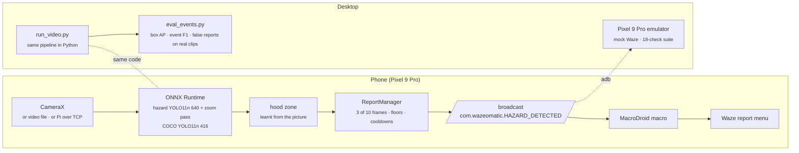

<div align="center">

# 🚧 wazeomatic

**Your dashcam reports the pothole so you don't have to.**

A phone mounted like a dashcam runs a small object detector, decides when it has really seen a
road hazard, and taps through the Waze report menu for you. Desktop simulator, Android app,
mock Waze and an automated emulator test, all in one repo.


</div>

---

## Why

Waze reports are typed by hand, which is the one thing a driver should not be doing. The camera
already sees the cone line, the lane-closed sign and the pothole long before the driver reaches
for the phone. Wazeomatic turns that into the report: a detector on the phone, a report manager
that insists on seeing the hazard in several frames before it believes it, and a MacroDroid
macro that presses the same buttons a person would.

## What it reports

> **A line of cones, drums or barricades, a "Right lane closed ahead" sign, a worker in hi-vis**
> → `HAZARD_ON_ROAD_CONSTRUCTION` → Waze: Hazard › Construction

> **A pothole in the lane ahead**
> → `HAZARD_ON_ROAD_POTHOLE` → Waze: Hazard › Pothole

> **An animal on the shoulder** (stock COCO classes)
> → `HAZARD_SHOULDER_ANIMALS` → Waze: Hazard

Each report is sent once per hazard type per minute, and only after the hazard has been seen in
3 of the last 10 inference frames above the report floor. Nothing is sent while the car is
parked behind a parking-garage cone.

## How it works



**The phone and the desktop run the same pipeline.** Box fusion, the zoom pass, the learnt hood
zone and the report manager exist once in Python (`wazeomatic/`) and once in Kotlin
(`android/detector/`), with the same defaults and the same unit tests on both sides, so a
threshold tuned on the desktop against real dashcam footage is the threshold the phone ships.

## Features

| | |
|---|---|
| 🎯 **Six-class hazard model** | YOLO11n fine-tuned on 46k images from seven sources (StarLine, CMU ROADWork, Argoverse 2 front camera with projected 3D labels, RDD2022, three pothole sets): pothole, cone, construction sign, delineator, barricade, worker. A YOLO11s twin is exported for machines that can afford it. |
| 🔍 **Two-pass zoom** | The hazard model runs on the frame and again on the road ahead, so a cone 30 px wide at 50 m is still found. |
| 🚘 **Learnt hood zone** | The dashboard keeps sharp edges in a running average of the frames while the road blurs away; whatever stays sharp at the bottom is the car, not a pothole. Found a 22 % dashboard that a fixed 10 % zone missed. |
| 🧮 **Ensembles that earn their keep** | Weighted Boxes Fusion over any number of models in parallel threads. Measured, and switched off where it did not pay. |
| 🧾 **Report manager, not a trigger** | Hits in a sliding window, per-label confidence floors, spatial tracking, per-type and global cooldowns. One event per real hazard. |
| 🧪 **Event-level evaluation** | `tools/eval_events.py` scores *reports*, not boxes: synthetic clips for recall, twelve minutes of real dashcam footage for the false-report rate, a threshold sweep, and a real lane closure as the positive control. |
| 📱 **Mock Waze** | A pixel-matched copy of the 2024 report flow (tiles, sheet, countdown) that logs every tap. The real app refuses to sign in on emulators (Play Integrity), so this is the emulator target. |
| 🤖 **Emulator suite** | One command boots a Pixel 9 Pro profile, installs both apps, rehearses the macro taps, replays a clip through the detector and checks that every mock report traces back to a detector event. 18 checks. |
| 🛑 **Dry run by default** | The macro stops one tap before Report unless `DRY_RUN` is off. Nothing in this repo files a real report on its own. |

## Numbers

Measured on the same 1,201 held-out images and the same five real clips (`docs/model-research.md`):

| | sprint-1 model | current (v3 nano) | v3 small |
|---|---|---|---|
| box AP50, all classes | 0.16 | 0.39 | 0.42 |
| construction event recall | 0.55 | 0.85 | 0.89 |
| overall event F1 | 0.66 | 0.82 | 0.85 |
| false reports on 12 min of real footage | 0 | 0 | 0 |
| model time per frame (desktop CPU, zoom on) | 29 ms | 25 ms | 86 ms |

## Quick start

### Desktop simulator

```powershell
python -m venv .venv; .venv\Scripts\activate
pip install -r requirements.txt
python tools/fetch_test_videos.py                      # CC0 dashcam clips -> assets/videos/
python tools/export_onnx.py --coco                     # stock COCO model -> models/
python -m wazeomatic.run_video assets/videos/dashcam_urban_1080p.mp4 --sink stdout --record runs/sim/out.mp4
```

`--sink adb --adb-dry-run` fires the broadcast on a connected phone or emulator, `--sink tcp:<ip>:8765`
feeds the phone app over the network, `--camera-sim` degrades frames to phone quality,
`--hazard-model models/hazard_yolo11s_v3.onnx` runs the bigger model. The hazard model files are not
committed; train them (below) or drop them into `models/`. Details: [docs/simulation.md](docs/simulation.md).

### Train and evaluate

```powershell
pip install -r requirements-train.txt                  # plus a CUDA build of torch
python tools/fetch_rdd2022_potholes.py                 # RDD2022 potholes
python tools/fetch_argoverse_hazards.py --stage annotations
python tools/fetch_argoverse_hazards.py --stage images --logs 100 --every 4
python tools/argoverse_to_yolo.py --check 6            # project the 3D cuboids, render a few frames
python tools/prepare_datasets.py --out C:/dev/datasets/wazeomatic_hazards_v3 --tile 1024 --tile-sources starline roadwork argoverse --tile-size roadwork=1080 --tile-size argoverse=1280
python tools/train.py --data C:/dev/datasets/wazeomatic_hazards_v3/data_train.yaml --imgsz 640 --batch 32
python tools/export_onnx.py --weights runs/train/hazard/weights/best.pt --imgsz 640
python tools/eval_events.py --model models/hazard_yolo11n.onnx --data C:/dev/datasets/wazeomatic_hazards_v3 --limit 120 --zoom-crop --sweep
```

Put the dataset on an SSD; from a hard disk the data loader starves the GPU. Sources, licences and every
measured number: [docs/model-research.md](docs/model-research.md).

### Phone

```powershell
cd android/detector; .\gradlew.bat assembleDebug      # bundles models/hazard_yolo11n.onnx and the COCO model
adb install -r app\build\outputs\apk\debug\app-debug.apk
```

Mount the phone like a dashcam, start the detector, then set up the MacroDroid macro from
[android_setup/macro_setup_guide.md](android_setup/macro_setup_guide.md) and the Intent trigger from
[docs/pipeline-to-macro.md](docs/pipeline-to-macro.md). Keep `DRY_RUN` on until you have watched it
stop at the confirm sheet a few times.

### Emulator suite

```powershell
powershell tools\emulator\create_avd.ps1               # Pixel 9 Pro, API 35 google_apis x86_64
python tools/emulator/run_e2e.py --install --video-seconds 60
```

Boots the emulator, installs the detector and mock Waze, and runs the 18 checks
([tools/emulator/README.md](tools/emulator/README.md)).

## Repository layout

| Path | Contents |
|---|---|
| `wazeomatic/` | Desktop pipeline: schema, ONNX detectors, box fusion, hood estimator, report manager, video runner |
| `tools/` | Dataset fetchers and builder, training, export, quantisation, benchmarks, event-level evaluation |
| `android/detector/` | Phone app: CameraX / video / TCP source, ONNX Runtime, same pipeline in Kotlin, broadcast sender |
| `android/mockwaze/` | Mock Waze with the 2024 report flow and an auto-macro service, for tests only |
| `tools/emulator/` | Pixel 9 Pro emulator scripts and the end-to-end suite |
| `android_setup/` | MacroDroid macro guide |
| `configs/` | Class schema and the mapping to Waze report types |
| `models/`, `assets/videos/` | Exported models and test clips (not committed; see their READMEs) |
| `docs/` | Architecture, model research, pipeline-to-macro contract, simulation, sprint status |

## Documentation

| Doc | Topic |
|---|---|
| [architecture.md](docs/architecture.md) | Components, data flow, phone vs Pi deployment, safety design |
| [model-research.md](docs/model-research.md) | Models, datasets and licences, class schema, every measured result |
| [pipeline-to-macro.md](docs/pipeline-to-macro.md) | Event JSON, Intent contract, MacroDroid setup, fallbacks |
| [simulation.md](docs/simulation.md) | Desktop simulator flags, emulator suite, dry-run testing |
| [sprint1.md](docs/sprint1.md) | Sprint goals and what was delivered |
| [user-stories.md](docs/user-stories.md) | User stories with story points |

## Status

The detection side is done and measured; the mock-Waze loop passes end to end on the emulator. Not yet
done: a drive with the real Pixel 9 Pro, the macro wired to the real Waze app (dry run), and the Raspberry
Pi camera path. Testing against real Waze is dry run only; never let automation file a report.
