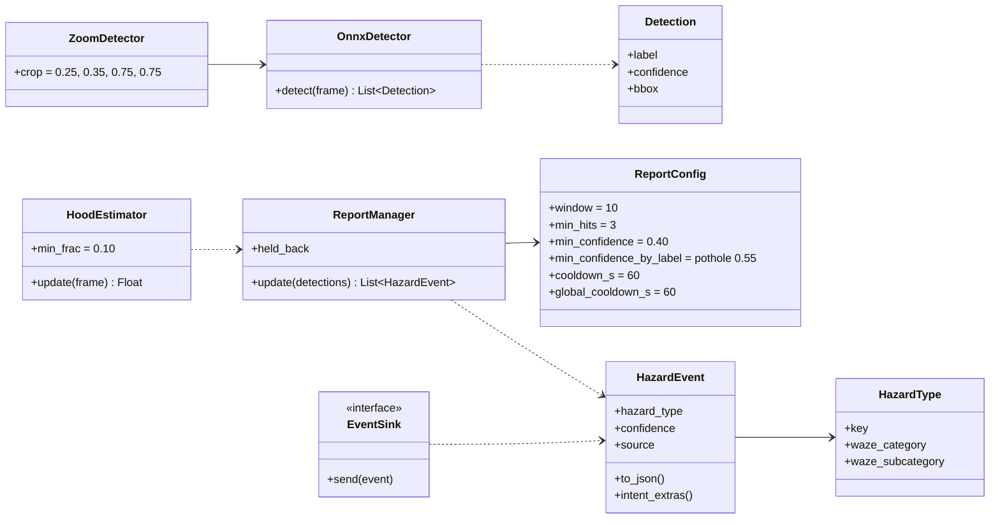

# Architecture

Diagram sources live in [diagrams/](diagrams/). The `.mmd` files are current and are repeated below so GitHub renders them. The `.png`/`.svg` files are rendered from the `.mmd` sources with mermaid-cli (`npx -p @mermaid-js/mermaid-cli mmdc -i 01_component.mmd -o 01_component.png -b white -s 2`); re-render after editing a source.

## Components

```mermaid
flowchart LR
    subgraph Capture["Frame sources"]
        direction TB
        Cam["«component»<br/>Phone camera (CameraX)"]
        Vid["«component»<br/>Test video / emulator webcam"]
        PiCam["«component»<br/>Pi camera (later)"]
    end

    subgraph Pipeline["Detection pipeline (phone app, desktop sim or Pi)"]
        direction TB
        Prep["«component»<br/>Letterbox preprocessor<br/>to each model's input size"]
        Hazard["«component»<br/>Hazard model, YOLO11n ONNX<br/>640 px, seven classes<br/>full frame + zoom crop of the road ahead"]
        Fuse["«optional»<br/>Weighted Boxes Fusion<br/>only with a second hazard model"]
        Coco["«component»<br/>COCO model, YOLO11n ONNX<br/>416 px, full frame"]
        Hood["«component»<br/>Hood zone estimator<br/>learnt dashboard band, min 10 %"]
        Veh["«component»<br/>Vehicle classifier, YOLO11n-cls<br/>civilian / police / ambulance / fire<br/>on the largest car, truck, bus boxes"]
        Wx["«component»<br/>Weather + road-surface classifiers<br/>whole frame / road patch, 2 Hz"]
        Scene["«component»<br/>Scene analyzer<br/>ego motion, flashing lights, traffic,<br/>crash, blocked lanes, dark signals, weather"]
        RM["«component»<br/>Report Manager<br/>persistence, cooldowns, already-in-Waze check"]
        Prep --> Hazard
        Prep --> Coco
        Prep --> Wx
        Hazard --> RM
        Hazard -. second model .-> Fuse
        Fuse -.-> RM
        Coco --> RM
        Coco --> Veh
        Veh --> RM
        Veh --> Scene
        Coco --> Scene
        Hazard --> Scene
        Wx --> Scene
        Scene -->|scene_* labels| RM
        Hood -->|hood zone| RM
    end

    Reader["«component»<br/>Waze reader, read only<br/>accessibility service / uiautomator<br/>alert cards ahead"]

    subgraph Delivery["Event delivery"]
        direction TB
        Bcast["Broadcast Intent<br/>com.wazeomatic.HAZARD_DETECTED"]
        Tcp["Pi to phone<br/>NDJSON over TCP :8765"]
        Hook["Fallback:<br/>MacroDroid webhook"]
    end

    subgraph Phone["Phone"]
        direction TB
        Macro["«component»<br/>MacroDroid macro<br/>hazard_type, DRY_RUN"]
    end

    Waze["«external app»<br/>Waze"]
    Mock["«test app»<br/>Mock Waze"]

    Cam --> Prep
    Vid --> Prep
    PiCam -. Pi variant .-> Prep
    Cam --> Hood
    Vid --> Hood
    RM -->|HazardEvent| Bcast
    RM -. Pi variant .-> Tcp
    Tcp -->|forwarded by phone app| Bcast
    RM -. fallback .-> Hook
    Bcast -->|Intent Received trigger| Macro
    Hook -.-> Macro
    Macro -.->|taps report menu| Waze
    Macro -.->|emulator tests| Mock
    Waze -.->|on-screen alerts| Reader
    Reader -->|reports Waze already has| RM

    classDef component fill:#edf4fc,stroke:#35577d,color:#142a42,stroke-width:1.5px;
    classDef optional fill:#f7f7f7,stroke:#8a8a8a,color:#333333,stroke-dasharray: 4 3;
    classDef transport fill:#f5f0e6,stroke:#92754f,color:#453623;
    classDef external fill:#e9f5ef,stroke:#36755b,color:#173e2c;
    class Cam,Vid,PiCam,Prep,Hazard,Coco,Hood,Veh,Wx,Scene,RM,Reader,Macro component;
    class Fuse optional;
    class Bcast,Tcp,Hook transport;
    class Waze,Mock external;
```

Files: [01_component.mmd](diagrams/01_component.mmd), [02_sequence.mmd](diagrams/02_sequence.mmd), [03_class.mmd](diagrams/03_class.mmd). The sequence diagram is in [pipeline-to-macro.md](pipeline-to-macro.md).

| Component | Where | Responsibility |
|-----------|-------|----------------|
| Frame source | `android/detector`, `wazeomatic/run_video.py` | Camera frames, an MP4 file, or the emulator webcam. Samples frames at the rate inference can keep up with. |
| Preprocessor | `wazeomatic/detector.py` (`letterbox`, `to_input_tensor`), Kotlin mirror in the app | Aspect-preserving resize and pad to the model's input size (grey 114), BGR to RGB, scale to [0, 1], NCHW float32. The size is read from each model's input shape: 640 px for the hazard model, 416 px for the COCO model. |
| Detectors | `OnnxDetector` | Two YOLO11n ONNX models: the fine-tuned seven-class hazard model (pothole, cone, construction_sign, delineator, barricade, worker, debris) and stock COCO (vehicles, people, animals). Decodes `[1, 4+nc, N]` output, per-class NMS, returns normalised boxes. The two models run side by side on their own threads. |
| Two-pass zoom | `ZoomDetector` in `wazeomatic/detector.py`, `ZoomCrop.kt` | Runs the hazard model a second time on a crop of the road ahead (default `0.25,0.35,0.75,0.75` as frame fractions), maps the boxes back and merges both passes with per-class NMS. On by default in `run_video.py` and the app. The COCO model is not zoomed unless `--zoom-coco` / `zoom_coco` is set. |
| Fusion (optional) | `wazeomatic/fusion.py`, `EnsembleDetector`, `BoxFusion.kt` | Weighted Boxes Fusion (or NMS) across hazard models when a second one is configured (`--ensemble-model`, `-PhazardModel2` in the app build). Off by default: one hazard model ships. |
| Hood zone | `wazeomatic/hood.py`, `HoodEstimator.kt` | Learns from the picture how much of the bottom of the frame is the car's own dashboard or bonnet (never less than 10 %). The Report Manager ignores boxes whose bottom edge is inside that band. |
| Vehicle classifier | `wazeomatic/classifiers.py` (`VehicleClassifier`), `VehicleClassifier.kt` | A YOLO11n-cls model on square crops (box grown 12 %, letterboxed) of the four largest COCO cars, trucks and buses. Emits `police_vehicle`, `ambulance` and `fire_truck` detections with the vehicle's box; police goes to the Report Manager like any hazard class, the responders feed the crash rule. |
| Weather and surface classifiers | `SceneClassifier`, `RoadSurface` (`classifiers.py`, `SceneClassifier.kt`, `RoadSurface.kt`) | Twice a second: clear / rain / snow / fog on the whole frame, and the road surface either on the patch of road just above the hood zone (RSCD-style model) or on a bird's-eye patch 15 m ahead warped with the camera geometry (RoadSaW-style model, skipped while a vehicle covers it). No road-surface model ships yet ([waze-coverage.md](waze-coverage.md), "Road surface"). |
| Scene analyzer | `wazeomatic/scene.py`, `SceneAnalyzer.kt` | Rules over time that no single box shows: ego motion from frame differences (or GPS speed), flashing red and blue lights, traffic standstill and heavy traffic, crash (lit responders that we approach or stand by), blocked lanes from cone lines, dark traffic signals, weather and road surface held for seconds. Emits `scene_*` detections, each with its own per-type cooldown ([waze-coverage.md](waze-coverage.md)). |
| Waze reader | `wazeomatic/waze_reader.py` (adb, desktop), `WazeWatcherService.kt` (accessibility, phone) | Reads Waze's alert cards, never taps. An event Waze already shows nearby is logged as a confirmation instead of being sent. |
| Report Manager | `wazeomatic/report_manager.py`, Kotlin mirror | Turns per-frame detections into rare events. See below. |
| Hazard schema | `wazeomatic/schema.py` | Hazard keys, Waze menu mapping, model-class mapping, event JSON and Intent extras. Single source of truth. |
| Sinks | detector app, `run_video --sink` | Broadcast Intent (phone), TCP (Pi to phone), stdout, JSON lines file, adb and HTTP (desktop testing). |
| MacroDroid macro | phone, see [macro guide](../android_setup/macro_setup_guide.md) | Receives the event, checks Waze is in the foreground and the one-per-minute guard, taps the report menu. |
| Mock Waze | `android/mockwaze` | Look-alike of the 2024 Waze report flow (same labels, tile order, layout and auto-send timing), logs which report was "sent". Used for automated runs. |

### Class view

The full class diagram (frame sources, the pipeline loop and each sink) is in [03_class.mmd](diagrams/03_class.mmd).

## Data flow

1. A frame is letterboxed to each model's input size and run through both models: the hazard model at 640 px on the full frame and again on a zoom crop of the road ahead (default crop `0.25,0.35,0.75,0.75`), the COCO model at 416 px on the full frame only. The two hazard passes are merged with per-class NMS. If a second hazard model is configured, the hazard models' boxes are fused (Weighted Boxes Fusion); by default only one ships, so nothing is fused.
2. Detections above the detector threshold (0.35) are mapped to a `hazard_type` through `DEFAULT_CLASS_TO_HAZARD` and the `hazard_map` in `configs/classes.yaml`. Unmapped classes are dropped. Cars, trucks and buses are not mapped: the scene rules turn one into `scene_car_on_shoulder` (`HAZARD_SHOULDER_CAR_STOPPED`) when it stands beside the road while we drive above 50 km/h (`wazeomatic/shoulder.py`, off by default).
3. **Hood zone:** boxes whose bottom edge lies in the car's own dashboard band at the bottom of the frame are ignored. The band is learnt from the picture and is never less than 10 % of the frame height.
4. **Persistence:** a hazard type needs at least 3 hits within the last 10 inference frames (Police 2, above its 0.85 floor: docs/waze-coverage.md). A hit needs confidence >= 0.40; a per-label floor can raise that (potholes need 0.55). The higher of the two applies, so a label floor never lowers the bar.
5. **Cooldown:** after an event, that hazard type is muted for 60 s, and no event of any type is sent for 60 s. The global cooldown matches the macro's one-report-per-minute guard. A hazard that qualifies while another report's cooldown is running is counted (`held_back` in the run stats, `heldBack` in the app) instead of being sent and dropped by the macro. When the minute is up, the type reported longest ago goes first, so a work zone that qualifies all along does not take every minute from a pothole or a police car that shows up later.
6. **Heuristic (experimental):** a vehicle in the right-hand shoulder region whose box grows by 1.35x across the window counts as stopped.
7. The resulting `HazardEvent` is delivered as a broadcast Intent (or JSON over TCP from the Pi, which the phone app turns into the same broadcast).
8. The macro maps `hazard_type` to taps in Waze. It has its own one-report-per-minute guard and a Waze-foreground check.

Spatial tracking (hits must come from boxes that overlap frame to frame) is implemented in the Report Manager but off by default (`track_iou` 0).

The contract between steps 7 and 8 is specified in [pipeline-to-macro.md](pipeline-to-macro.md).

## Deployment variants

| | Phone only (sprint 1 target) | Pi camera + phone (later) |
|---|---|---|
| Camera | Phone rear camera in a windscreen mount | Pi camera module on the Pi |
| Inference | Detector app, ONNX Runtime Android, XNNPACK CPU provider | Python `wazeomatic` package with ONNX Runtime CPU on the Pi |
| Model | fp32 ONNX: hazard model at 640 px, COCO model at 416 px | The same ONNX files |
| Delivery | In-process to broadcast | NDJSON over TCP port 8765 on the local network or phone hotspot; phone app re-broadcasts |
| Waze UI | MacroDroid on the same phone | MacroDroid on the phone (unchanged) |
| Main limit | Thermal and battery while also running Waze | CPU latency on the Pi |

The same fp32 640 px hazard ONNX file runs everywhere, so the desktop numbers, emulator runs and on-device runs all test the same model and the same post-processing. An int8 copy and smaller input sizes are not exported for the seven-class model; the int8 and 320/416 px hazard files in `models/` are older four-class models kept for comparison ([models/README.md](../models/README.md)).

## Safety design

Waze has no sandbox or test server. Any report sent from the real app is visible to other drivers. So:

- **Automation never taps the final send on real Waze.** The macro has a `DRY_RUN` variable (default `true`). In dry-run it performs every navigation step, takes a screenshot, and backs out instead of sending.
- **Full end-to-end runs use the mock Waze app** on a Pixel 9 Pro emulator profile. The mock app records the report it would have sent, so tests can assert on it.
- **The pipeline cannot spam.** The Report Manager's per-type and global cooldowns are both 60 s, so the pipeline sends at most one event per minute in total, and the macro has its own one-per-minute guard. A misfiring model produces at most about one report per minute.
- **Every event carries `dry_run`, and every sender defaults it to `true`.** The detector app's dry-run setting is on by default, and the desktop adb sink sends `dry_run=true` unless `run_video.py` is started with `--adb-live`. A receiver can therefore refuse to send live even if the macro variable is wrong.
- Live reports from a real drive are a manual decision by the driver, not part of any test.

Procedures are in [simulation.md](simulation.md).
