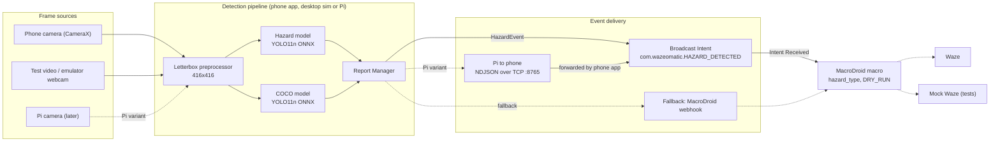
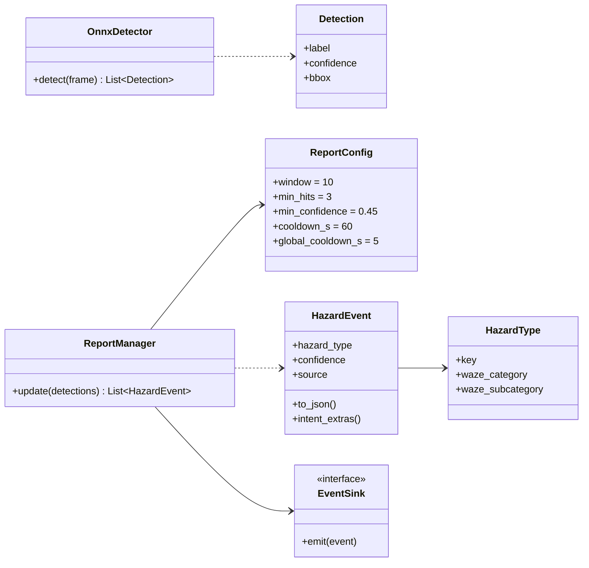

# Architecture

Diagram sources live in [diagrams/](diagrams/). The `.mmd` files are current and are repeated below so GitHub renders them. The `.png`/`.svg` files are rendered from the `.mmd` sources with mermaid-cli (`npx -p @mermaid-js/mermaid-cli mmdc -i 01_component.mmd -o 01_component.png -b white -s 2`); re-render after editing a source.

## Components

Files: [01_component.mmd](diagrams/01_component.mmd), [02_sequence.mmd](diagrams/02_sequence.mmd), [03_class.mmd](diagrams/03_class.mmd). The sequence diagram is in [pipeline-to-macro.md](pipeline-to-macro.md).

| Component | Where | Responsibility |
|-----------|-------|----------------|
| Frame source | `android/detector`, `wazeomatic/run_video.py` | Camera frames, an MP4 file, or the emulator webcam. Samples frames at the rate inference can keep up with. |
| Preprocessor | `wazeomatic/detector.py` (`letterbox`, `to_input_tensor`), Kotlin mirror in the app | Aspect-preserving resize and pad to the model size (grey 114), BGR to RGB, scale to [0, 1], NCHW float32. |
| Detectors | `OnnxDetector` | Two YOLO11n ONNX models: the fine-tuned hazard model and stock COCO (vehicles, people, animals). Decodes `[1, 4+nc, N]` output, per-class NMS, returns normalised boxes. |
| Report Manager | `wazeomatic/report_manager.py`, Kotlin mirror | Turns per-frame detections into rare events. See below. |
| Hazard schema | `wazeomatic/schema.py` | Hazard keys, Waze menu mapping, model-class mapping, event JSON and Intent extras. Single source of truth. |
| Sinks | detector app, `run_video --sink` | Broadcast Intent (phone), TCP (Pi to phone), stdout and adb (desktop testing). |
| MacroDroid macro | phone, see [macro guide](../android_setup/macro_setup_guide.md) | Receives the event, checks Waze is in the foreground and the one-per-minute guard, taps the report menu. |
| Mock Waze | `android/mockwaze` | Look-alike of the 2024 Waze report flow (same labels, tile order, layout and auto-send timing), logs which report was "sent". Used for automated runs. |

### Class view

The full class diagram (frame sources and each sink) is in [03_class.mmd](diagrams/03_class.mmd).

## Data flow

1. A frame is letterboxed to 416x416 (320 as the fast option) and run through both models.
2. Detections above the model threshold (0.35) are mapped to a `hazard_type` through `DEFAULT_CLASS_TO_HAZARD`. Unmapped classes are dropped. Cars, trucks and buses only map to `HAZARD_SHOULDER_CAR_STOPPED` through the stopped-vehicle heuristic, which is off by default.
3. **Persistence:** a hazard type needs at least 3 hits with confidence >= 0.45 within the last 10 inference frames.
4. **Cooldown:** after an event, that hazard type is muted for 60 s, and no event of any type is sent for 5 s.
5. **Heuristic (experimental):** a vehicle in the right-hand shoulder region whose box grows by 1.35x across the window counts as stopped.
6. The resulting `HazardEvent` is delivered as a broadcast Intent (or JSON over TCP from the Pi, which the phone app turns into the same broadcast).
7. The macro maps `hazard_type` to taps in Waze. It has its own one-report-per-minute guard and a Waze-foreground check.

The contract between steps 6 and 7 is specified in [pipeline-to-macro.md](pipeline-to-macro.md).

## Deployment variants

| | Phone only (sprint 1 target) | Pi camera + phone (later) |
|---|---|---|
| Camera | Phone rear camera in a windscreen mount | Pi camera module on the Pi |
| Inference | Detector app, ONNX Runtime Android, XNNPACK CPU provider | Python `wazeomatic` package with ONNX Runtime CPU on the Pi |
| Model | Same ONNX files (int8 or fp32, 416 or 320) | Same ONNX files, likely 320 int8 for speed |
| Delivery | In-process to broadcast | NDJSON over TCP port 8765 on the local network or phone hotspot; phone app re-broadcasts |
| Waze UI | MacroDroid on the same phone | MacroDroid on the phone (unchanged) |
| Main limit | Thermal and battery while also running Waze | CPU latency on the Pi |

Using one ONNX file everywhere means the desktop numbers, emulator runs and on-device runs all test the same model and the same post-processing.

## Safety design

Waze has no sandbox or test server. Any report sent from the real app is visible to other drivers. So:

- **Automation never taps the final send on real Waze.** The macro has a `DRY_RUN` variable (default `true`). In dry-run it performs every navigation step, takes a screenshot, and backs out instead of sending.
- **Full end-to-end runs use the mock Waze app** on a Pixel 9 Pro emulator profile. The mock app records the report it would have sent, so tests can assert on it.
- **The pipeline cannot spam.** Per-type 60 s and global 5 s cooldowns in the Report Manager, plus the macro's own one-per-minute guard, mean a misfiring model produces at most about one report per minute.
- **Every event carries `dry_run`** so a receiver can refuse to send live even if the macro variable is wrong.
- Live reports from a real drive are a manual decision by the driver, not part of any test.

Procedures are in [simulation.md](simulation.md).
