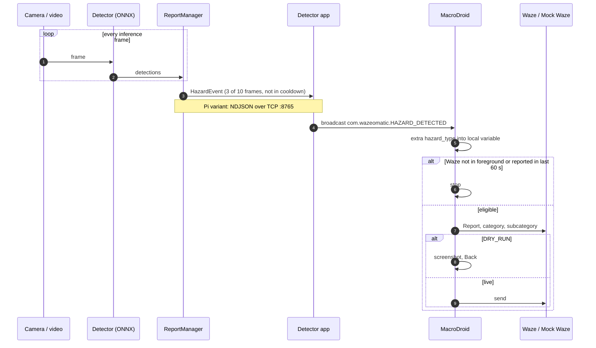

# Pipeline to macro contract

How a detection becomes a Waze report. The pipeline side is defined in `wazeomatic/schema.py` (schema version 1). The macro side is the teammate's macro described in [android_setup/macro_setup_guide.md](../android_setup/macro_setup_guide.md); this page covers only the parts that connect to it.

## End to end



Source file: [diagrams/02_sequence.mmd](diagrams/02_sequence.mmd).

## Event JSON

`HazardEvent.to_json()` produces one compact JSON object. This is what the Pi sends over TCP and what `run_video --sink stdout` prints.

```json
{"hazard_type":"HAZARD_ON_ROAD_POTHOLE","confidence":0.71,"source":"phone","ts":1762370000.123,
 "frame_index":412,"bbox":[0.48,0.81,0.12,0.06],"label":"pothole","lat":null,"lon":null,"schema":1,
 "waze_category":"Hazard","waze_subcategory":"Pothole"}
```

| Field | Type | Notes |
|-------|------|-------|
| `hazard_type` | string | Key from `HAZARD_TYPES`. The macro switches on this. |
| `confidence` | float | Best confidence in the persistence window |
| `source` | string | `phone`, `pi` or `sim` |
| `ts` | float | Unix seconds |
| `frame_index` | int | Inference frame counter |
| `bbox` | [cx, cy, w, h] | Normalised to the source frame |
| `label` | string | Model class, e.g. `cone` |
| `lat`, `lon` | float or null | Not filled in sprint 1 (Waze uses its own GPS fix) |
| `schema` | int | Bump when a field changes meaning |
| `waze_category`, `waze_subcategory` | string | Informational; the macro does not need them |

### hazard_type values

| hazard_type | Waze menu (schema.py) | Sprint 1 |
|-------------|------------------------|----------|
| `HAZARD_ON_ROAD_POTHOLE` | Hazard > Pothole | yes |
| `HAZARD_ON_ROAD_CONSTRUCTION` | Hazard > Construction | yes |
| `HAZARD_SHOULDER_ANIMALS` | Hazard (no subtype; Waze removed Animals) | yes |
| `HAZARD_SHOULDER_CAR_STOPPED` | Hazard > Car on shoulder | experimental |
| `HAZARD_ON_ROAD_OBJECT` | Hazard > Object | not detected yet |
| `POLICE` | Police | deferred |
| `CRASH` | Crash | deferred |

Since the 2024 redesign the Hazard tile opens a flat list: Construction, Car on shoulder, Broken traffic light, Pothole, Object ([Waze Help](https://support.google.com/waze/answer/13739290?hl=en)). Hazard itself is preselected, so an animal is reported as a plain Hazard. The macro taps by the label the installed Waze shows; the `hazard_type` keys never change.

## Android Intent

| | Value |
|---|---|
| Action | `com.wazeomatic.HAZARD_DETECTED` |
| Type | Broadcast (`sendBroadcast`), no category, no data URI |
| Extras (all strings) | `hazard_type`, `confidence` (3 dp), `ts` (3 dp), `source`, `waze_category`, `waze_subcategory`, `dry_run` (`"true"`/`"false"`) |

All extras are strings because MacroDroid stores them in string variables. `dry_run` is added by the sender (detector app setting; `run_video --sink adb --adb-dry-run` on the desktop); the other extras come from `HazardEvent.intent_extras()`.

Test from a PC without the detector app:

```powershell
adb shell am broadcast -a com.wazeomatic.HAZARD_DETECTED --es hazard_type HAZARD_ON_ROAD_POTHOLE --es confidence 0.900 --es source sim --es dry_run true
```

## MacroDroid setup

These steps add the trigger and dry-run handling to the existing macro. The MacroDroid Intent Received trigger matches an action string and can save each extra into a variable; extra values match with wildcards by default, regex optionally ([MacroDroid wiki](https://macrodroidforum.com/wiki/index.php/Trigger:_Intent_Received)). Names are case-sensitive.

1. **Trigger:** Add trigger, search for *Intent Received*.
   - Action: `com.wazeomatic.HAZARD_DETECTED`
   - Category and data: leave empty.
   - Extras: add `hazard_type`, value `*`, save to variable `hazard_type` (the macro's existing local variable). Add `dry_run`, value `*`, save to local variable `dry_run_extra`. Optionally `confidence` into `confidence`.
2. **Variables:** in the macro's local variables, keep `hazard_type` (string) and add `dry_run_extra` (string). Add a global boolean `DRY_RUN`, default `true`, so it can be flipped from the MacroDroid home screen without editing the macro.
3. **Constraints:** add the application-in-foreground constraint for Waze (the guide already checks foreground focus; keeping it as a macro constraint means the macro does nothing when Waze is not open). Keep the existing one-report-per-minute guard.
4. **Actions:** the existing If/Else on `hazard_type` selects the tap sequence. Before the final send tap, add:
   - If `DRY_RUN` = true **or** `dry_run_extra` = `true`: Take Screenshot, then tap **Cancel** (or press Back until the sheet is closed), stop.
   - Else: tap **Report** (or let Waze's auto-send countdown finish).
   - Mind the countdown: Waze sends the report by itself a few seconds after the confirm sheet opens, so the dry-run branch has to cancel before that. Keep the waits between the category tap, the subtype tap and Cancel short (about 1 s each). The mock app reproduces this with `auto_send_ms` (default 5 s) and logs a `trigger=timeout` send when a macro is too slow, so test the timing there first.
5. **Permissions:** grant MacroDroid its accessibility service (needed for UI interaction taps), and set MacroDroid's battery usage to *Unrestricted*.
6. **Test:** with Waze open and `DRY_RUN` on, run the `adb shell am broadcast` command above. The macro should walk to the pothole screen, screenshot, and back out.

## DRY_RUN semantics

| `DRY_RUN` (macro) | `dry_run` (extra) | Behaviour |
|---|---|---|
| true | any | Every step except send; screenshot; back out |
| false | `true` | Same as above |
| false | `false` | Live report. Only a driver on a real drive should set this. |

Dry-run is the default on both sides. Automated tests never set both to false on a phone with real Waze.

## Fallback 1: MacroDroid webhook

If broadcasts cannot be used (for example, the sender is not on the phone), MacroDroid's Webhook trigger accepts HTTP GET or POST at

```
https://trigger.macrodroid.com/<device-id>/<identifier>?hazard_type=HAZARD_ON_ROAD_POTHOLE&dry_run=true
```

`<device-id>` is generated by MacroDroid on first run and changes on reinstall; `<identifier>` is chosen in the trigger. Query parameters set macro variables of the same name ([MacroDroid webhook announcement](https://medium.com/@macrodroid/introducing-the-webhook-trigger-a760e2ee140d), [wiki](https://macrodroidforum.com/wiki/index.php/Trigger:_Webhook_(URL))). The request goes through MacroDroid's server, so it needs internet on both ends and adds latency. Treat the URL as a secret.

## Fallback 2: Pi to phone over TCP

For the Pi variant the phone app runs a TCP server on port **8765**. The Pi connects as a client and writes one event per line (newline-delimited JSON, the format above, `source` = `pi`). The phone app parses each line, validates `schema` and `hazard_type`, and sends the same broadcast, so the macro is unchanged. Both devices must be on the same network (phone hotspot works). Desktop equivalent: `python -m wazeomatic.run_video <clip> --sink tcp:<phone-ip>:8765 --event-source pi`.

## Cooldown responsibilities

| Rule | Where | Why |
|------|-------|-----|
| 3 hits in 10 frames, conf >= 0.45 | Pipeline | Ignore single-frame flicker |
| Boxes touching the bottom 10 % of the frame ignored | Pipeline | The car's own bonnet reflection is not a pothole |
| Same hazard type at most once per 60 s | Pipeline | Do not report one pothole repeatedly |
| Any events at least 5 s apart | Pipeline | Give the macro time to finish a tap sequence |
| One report per minute, Waze in foreground | Macro | Avoid Waze rate limits; never tap in another app |

Both sides guard independently, so a fault on one side cannot cause a burst of reports.

## Troubleshooting

| Symptom | Check |
|---------|-------|
| Macro never fires | Action string and extra names are case-sensitive. Confirm with the `adb shell am broadcast` test. Since Android 8, manifest receivers do not get most implicit broadcasts, but receivers registered at runtime (as MacroDroid's are) do ([Android broadcasts](https://developer.android.com/develop/background-work/background-tasks/broadcasts)). If MacroDroid is killed, nothing is registered. |
| Works, then stops after a while | Battery optimisation: set MacroDroid and the detector app to *Unrestricted*. Keep MacroDroid's notification enabled. |
| Trigger fires but no taps | MacroDroid accessibility service was turned off (Android disables it after some updates). Re-enable in Settings > Accessibility. |
| Taps land on the wrong item | Waze menu changed or a different screen size. Compare with the mock app and update tap targets by label. |
| `hazard_type` variable empty | Extra saved to a different variable name, or sent as a non-string. Send with `--es`. |
| Pi events not arriving | Phone IP changed, port 8765 blocked, or the app's TCP server not started. Test with `run_video --sink tcp` from a laptop. |
